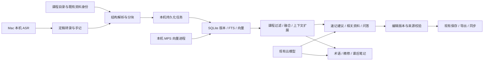

# 智能课堂改造：实现与验收记录

记录日期：2026-10-14。代码分支：`codex/course-knowledge-classroom-20261014`。本次在独立工作区实现；原目录源码保持在 `e9d45113e98a8f7fe6bac45d85bc5f2b305428fa`，没有正式合并、GitHub 推送或外部笔记写入。

## 可运行结果

新版复用现有课程文件身份和目录，提供本机建库、混合检索、版本过滤、文件/PDF/音频回跳、随堂速记、资料侧栏、分范围问答、动态术语及课后证据辅助。手动课件/章节/页码保存到本机课次上下文，相关资料、速记、问答与精修共同使用；指定页的公式可用于定位指代问题。原录音、课程回放、PDF 转换、精修、Markdown 编辑、导出、任务中心和 IdeaShell 入口保留。独立启动入口见《智能课堂-使用与恢复》。8898 是使用课程副本的隔离验收页；8765 仍为原版正式服务。

业务任务、资料和索引均在 Mac。新增检索与向量路径没有远程节点调用。原 Windows 回执恢复路径保留；不明确的旧远程操作仍先对账。新实时录音在 Mac，新上传默认在 Mac，明确关闭本机选项后可使用现有加速设置。新增 Windows embedding/reranker worker 本轮未部署。

## 实际功能验收

- 使用真实课程“通信原理 C”和“物理光学”的副本，复用原 PDF 文本层及已有成功转换、附件；没有启动新 MinerU，没有批量移动或重命名原件。
- 2026-10-14 通信原理录音中约 01:22:49–01:23:53 的真实音频片段，经浏览器 AudioContext 输出为输入流，走页面 WebSocket、Mac Qwen3-ASR 与录音保存。没有注入预制转录。由于原音频音量低，输入做了统一幅度放大；浏览器直接测试物理麦克风尚未完成。
- 实时样例课次 `20261014-151903-7b8c2a` 得到 3 个实际 ASR 片段，约 65 秒有效讲授，内容涉及包络检波、小信噪比、门限效应及相干解调。测试录音还含静音和调试时间，不能把录音总时长当作有效讲授时长。
- 保存关键词“门限效应，为什么小信噪比突然变差？”，生成分区建议；逐条引文、资料来源和时间保留。实际点击接受、撤销、编辑保护和锁定；人工标记 `MANUAL_KEEP_20261014` 在再生成和接受后仍存在，原始输入独立保存。
- 真实课后上传任务 `upload:d83bf9a173a94ce6834d29d895811802` 保留同一任务与源音频，恢复后完成本地 ASR、逐段修正和全局精修。原始 ASR、精修提议与高风险待核对候选分开保存。
- 原版正式 IdeaShell 只读连接恢复为 connected。未提交正式笔记/附件写入。隔离页拒绝推送、拉取、核对写入，显示正式版入口；不能把只读连接或模拟测试当作同步写入验收。

## 模型实测与默认选择

重新确认硬件为 Apple M4、24 GiB。使用官方未量化权重、PyTorch MPS，固定模型 revision、维度、最后有效 token 池化、float32 L2 归一化及查询/文档提示。没有量化模型，因而没有量化质量对比结论。准备方式和固定契约见使用说明及 `requirements-knowledge.lock`。

使用两门真实课程的 52 段 PDF/课堂文本：9 个可回答查询、2 个无答案探针，覆盖中文语义、英文术语、中英混写、公式描述、同义提问和跨课同词。相关性标签由文本阅读核对，未建立人工音频金标准。

| 指标 | Qwen3-Embedding-0.6B | Qwen3-Embedding-4B |
|---|---:|---:|
| 语义召回 Hit@5（9 个正例） | 8/9 | 9/9 |
| 词法与语义融合 Hit@5（有界样本） | 9/9 | 9/9 |
| 冷加载 | 2.04 秒 | 14.31 秒 |
| 52 段建向量（含冷加载） | 11.79 秒 | 42.37 秒 |
| 热查询中位数（向量编码） | 0.036 秒 | 0.153 秒 |
| 进程 RSS 测量值 | 约 2.30 GiB | 约 5.37 GiB |
| Metal driver 分配测量值 | 约 1.36 GiB | 约 7.91 GiB |

默认选择 4B，以这批样本中较好的纯语义召回作为依据；0.6B 是显式可选轻量配置，不能混用其向量。RSS 和 Metal driver 指标属于不同口径，不相加称作整机峰值。冷启动数值来自当次运行，不是稳定 SLA。

Qwen3-Reranker-4B 对 5 个候选的中位处理时间约 7.85 秒，冷加载约 50.13 秒，该批正例 Hit@5 仍为 9/9，没有增益。默认使用融合排序；重排是设置中明确启用的课后操作，有批次、候选数与时间限制。样本较小，不据此断言重排在大规模资料上没有收益。

生成默认复用已实际调用的 AGY `gemini-3.8-flash-high`，High 推理。速记、问答和课后功能分别保存配置，完整课堂模式保留全部定稿文本并检查窗口，不会悄悄删去课堂开头。实时模型的高推理质量取舍仍需更多课堂观察；本轮不宣称低延迟达到数秒。

官方依据：[Embedding 4B](https://huggingface.co/Qwen/Qwen3-Embedding-4B)、[Embedding 0.6B](https://huggingface.co/Qwen/Qwen3-Embedding-0.6B)、[Reranker 4B](https://huggingface.co/Qwen/Qwen3-Reranker-4B)、[Gemini 官方模型资料](https://ai.google.dev/gemini-api/docs/latest-model)。EmbeddingGemma 2 的官方资料做了候选核对，本轮实际下载和比较限于上述两个 embedding，不声称比较过全部候选。

## 效果边界与失败记录

实际原版关键词接口与新版完整资料库的逐查询结果保存在 `output/knowledge-development/actual-search-comparison.json`。有界 52 段样本的命中率不能直接替代完整课程的检索结果。完整资料库初次对照发现精修块没有带原始 segment_ids，导致相关结果可读而来源映射失败；已修复，分块器版本升到 v3，增量更新复用兼容的已有向量。

最终完整资料库的 9 个正例按预先标注的原片段/PDF 页 ID 严格匹配：新版 8/9，原版关键词接口 0/9。布儒斯特角查询没有命中预标注的第 1701 段；其第一结果仍返回了同堂课关于反射 p 分量为零的精修说明和另一段映射。这是标签覆盖与排序的限制，仍保留为严格匹配未命中，不改标签制造满分。2 个无答案探针仍有相似候选；它们不是答案，不能由向量分数判断有答案。

同一门限效应问题的实际生成对照：原问答耗时约 73.15 秒，新问答约 50.60 秒；网络与缓存状态不同，不能认定稳定速度提升。原问答从历史回答沿用了旧 K 引用，新问答重新检索了当前版本并通过引用身份校验。引用身份通过不等于数学条件或解释已经获得语义支持。本次保留完整回答和证据，未用模型自评制造正确率。

静态术语与动态术语的数量、选择理由和来源保存在对照文件；动态词表保留原配置并按当前证据排序。没有人工逐字音频标签，不报告术语识别准确率、CER/WER、精修准确率或人工修改量百分比。原始 ASR 与精修文本独立保留，便于后续分别评分。

直接扩写与有来源约束的增强在同一真实课堂上留有实际输出。无约束回答可能沿用旧问答中的引用；速记增强按结构化 claims 重构正文，未知编号、缺失引文、不支持的敏感值会剔除，转述和推导标为待复核。本次真实增强也出现 2–3 条未通过检查的陈述，已保留在校验记录中。没有完整人工语义审计，不报告无依据补充或引用支持率百分比。

失败也保留：

1. 浏览器默认假麦克风给出静音；原片段振幅不足触发 VAD。改为真实 WAV 流并做统一增益后得到真实 ASR。失败的空录音没有被伪装成成功。
2. 隔离页没有正式 OAuth 授权，推送暴露 TaskGroup 的外层错误。正式源码未改；正式连接恢复并验证只读，测试页加入明确隔离提示与写入限制。
3. 测试启动器曾指向工作区里不存在的 ASR 目录。修正为复用主仓库已安装模型或显式传入路径，保留同一上传任务重试。
4. 实际 AGY 出现临时 503。手记、音频和进度保持；503 识别为可恢复，重试成功。可恢复云错误会退避重试，最长间隔 5 分钟；取消、锁定或永久配置错误停止自动生成。未实测断开整机网络再恢复的长时现场流程。
5. 普通 SSE 连接曾延迟服务关闭。隔离启动器增加唯一进程锁和 10 秒连接关闭预算；知识任务在停止时标 interrupted，重启恢复，区别于用户取消。早期隔离进程还做过一次强制中断，SQLite 源版本事务保持可读。正式原程序没有应用这些修改。
6. 超长完整结构块超过 embedding 输入预算时，保持全文词法可查，其他块仍向量化，不截断数字/表格/公式。界面说明实际策略，不能把它称作全部向量覆盖。

## 回归与未验证项

最终完整 Python 回归 391 项、16 个 JavaScript 测试套件、23 个离线浏览器回归场景的最终记录均在 `output/knowledge-development`。离线浏览器用合成接口验证旧页面交互，和真实录音/模型验收分别记录。

新增回归覆盖课程隔离、原件改变而转换件未变、原子版本切换、删除恢复、缓存/模型契约、同文复用向量、公式/数值不切断、长结构块部分向量化、精修音频映射、无依据实体、错误引用、人工编辑/晚到结果、撤销来源、重复接受、取消后新转录不重启、后台线程调度、服务中断恢复、长时云故障恢复状态、术语修改失效、OOXML 结构解析。

尚未完成：两小时物理麦克风课堂；人工音频金标准与统计性准确率；整机断网再联网；真实 Windows 接受后断连/重新对账的新增知识模型 worker；新版正式 IdeaShell note_create/note_update 与附件写入。既有同步、远程任务和回放链路回归通过，不把模拟通过称为外部服务全验收。

## 兼容与后续

课程原件和旧录音结构不迁移、不移动。新增课程身份侧车、SQLite 派生索引、每课次速记 JSON 和独立服务端模型配置。日常备份包含身份/正文/历史，排除可重建 SQLite；独立 SQLite 备份采用在线 backup 或停服保存 DB/WAL。恢复原程序仅需停止新版、从原目录启动，无需回滚 Git。模型升级显式重建，旧契约不混入查询。

主要新模块：`knowledge/`（存储、解析、模型、任务、检索）、`classroom_intelligence/`（速记版本、建议、相关资料、配置与导出）、`transcription_assist/`（术语和高风险纠错）、`local_compute.py`（资源租约）。原 app/live/AI/batch 中只接入生命周期与共享服务，主要逻辑没有继续堆到这些大文件。

后续可选工作：Windows 契约一致的向量/重排 worker；人工标注更多真实课堂问答与术语；按课程样本选择重排策略；可靠的 PDF 附件页映射；长时麦克风与断网验收。知识图谱、多模态大索引和复杂代理未作为核心依赖。

隔离页最终迁到端口 8898，因为 8878 被另一个应用占用；其进程未被修改或停止。早期验收日志中的 8878 指当时的 QwenASR 隔离服务。

最终现场补验：手动选择“通信原理-信道翻转课堂课件.pdf”第 64 页，课次上下文成功保存；相关资料返回该页，来源接口返回内联 PDF，Markdown 导出带当前服务端口的可打开来源。测试后恢复自动关联。
此前一次课后重新生成受 AGY 临时 503 影响而失败，旧的详细正文、已接受手记及音频保留；失败记录保留，随后重新生成的最终成功结果见下文。普通纠错同时保存模型、修改输入/提议、来源版本和候选依据；候选依据不声明已经逐项支持每个改动。

AGY 接口最终核对：当前 CLI 对固定 `gemini-3.8-flash-high` 拒绝额外 `--effort high` 参数。适配器已保留同一 High 型号、移除不受支持的参数；真实调用返回“调用成功”（约 19.19 秒），没有更换模型。`agy models` 当次列表请求超时，未以它宣称整个模型目录可用。

最终课后整理已在 2026-10-14 21:07 保存完成：详细正文、短摘要、已接受手记和 9 条资料引用均已写入本机；任务状态 completed，未知或过期引用列表为空。此前的 503、参数失败和中断记录保留，修复后真实完整请求成功。身份/版本校验通过仍不代表全部论断人工语义审核完成。结果见 `output/knowledge-development/latest-postclass-integration.json` 与 `门限效应-课后复习笔记.md`。

正式同步最终复核：原版也曾短暂显示 TaskGroup 外层错误；直接复用原授权的只读 MCP 工具列表请求成功返回 16 个工具，原版源码始终未变。另行重连状态保存在 `formal-sync-reconnect.json`。该次间歇故障未能复现具体内层原因，不能把全部 TaskGroup 错误都归因于测试页无授权；没有进行真实笔记写入验证。
